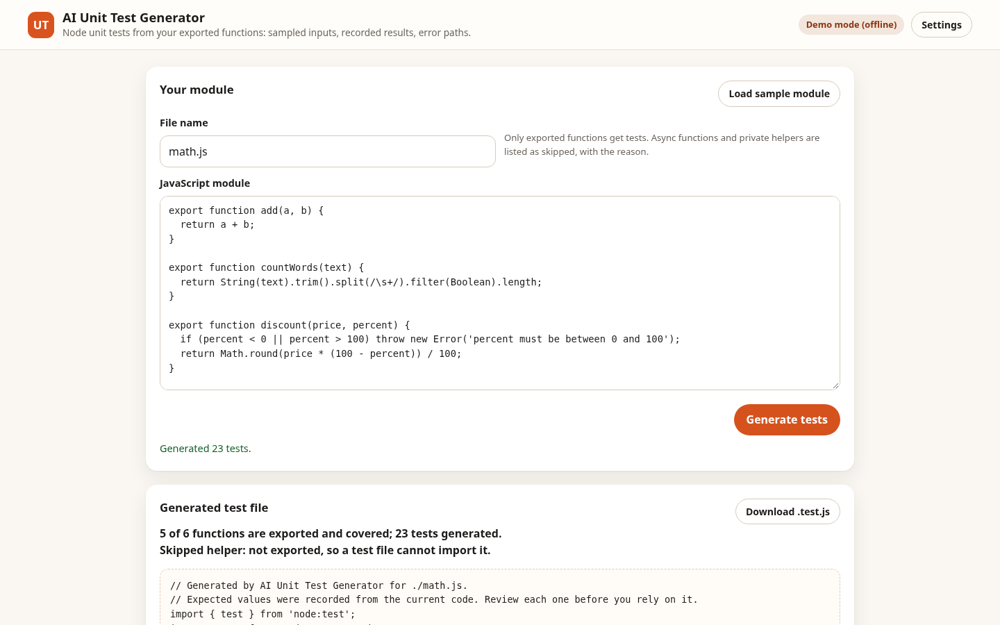

# AI Unit Test Generator

Paste a JavaScript module and get a node:test file for its exported functions. Expected values are recorded by running the code on sampled inputs, error paths become assertions that throw, and the summary says what was skipped and why. Demo mode is fully offline and deterministic; live mode asks any OpenAI-compatible model for a test file.



## Features

- Finds exported functions and arrow functions, and skips async functions and private helpers with the reason shown.
- Picks sample inputs from parameter names (numbers, strings, arrays, booleans, null) and records what each function returns or throws.
- Writes Node node:test files with assert/strict; the generated file imports the module and runs under node --test.
- Labels tests that call another function in the module as integration tests.
- Download the file as .test.js with one button.
- Live mode produces a model-written test file from the same module, with the same warning to review it.

## Demo mode and live mode

- **Demo mode (default, offline).** Every feature runs with local, deterministic logic. No key, no network calls.
- **Live mode.** Open **Settings**, enter an API base URL, key and model for any OpenAI-compatible chat-completions endpoint, then tick *Use the live model in this app*. The model writes the test file from the module source; the app shows it unchanged and reminds you to read it.
- Settings are stored only in this browser's `localStorage`. The key is sent only to the endpoint you configure, never committed, and never sent anywhere else.

## Quick start

```bash
python3 -m http.server 8080
# then open http://localhost:8080
```

Or open `index.html` through any static server. There is no build step and no runtime dependency.

## Tests

```bash
npm test          # Node built-in test runner: 35 unit tests
python3 tests/e2e/smoke.py   # Playwright end-to-end: 18 checks at 390x844 and 1440x900
```

The end-to-end script serves the app locally, runs the main flow in demo mode and again against a mocked OpenAI-compatible endpoint, and fails on console errors or sideways scrolling.

## Structure

```
src/core/   pure logic (no DOM): analysis, rules, LLM client, settings
src/ui/     DOM wiring: settings panel, small helpers
src/app.js  UI entry point
tests/unit  node --test suites
tests/e2e   Playwright smoke test
```

## Limitations

- Demo expectations are recorded from current behaviour (characterisation tests). They pin what the code does now, including bugs, so review each one.
- Inputs are guessed from parameter names; functions that need specific data (objects with fields, dates, network) get weak coverage.
- Async functions and private helpers are not tested in demo mode. They are listed as skipped.
- At most six cases per function, from the first two parameters.
- It does not measure coverage. The summary counts functions and tests only.

## Licence and credit

MIT License. Copyright (c) 2026 Nived NS. See [LICENSE](LICENSE).

Built by Nived NS.

Created and owned by Nived NS - https://github.com/connectnived-lab
